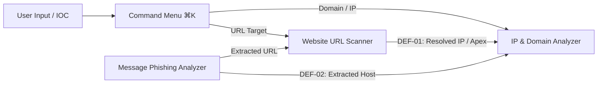

# CYBERCORE // FINAL RELEASE READINESS AUDIT

**Platform:** CYBERCORE // Threat Intel & Security Investigation Platform  
**Frontend Path:** `/Users/yashrajdnyaneshwarkuyate/cybercore_fr`  
**Backend Path:** `/Users/yashrajdnyaneshwarkuyate/CyberCore/backend`  
**Audit Date:** November 1, 2026  
**Audit Mode:** STRICT READ-ONLY VERIFICATION (No Source Code Alterations)  
**Final Status:** **`READY FOR SUBMISSION`**

---

## 1. Executive Summary & Verdict

This audit provides the definitive release readiness assessment of the CYBERCORE platform across its frontend routes, architectural visual identity, viewport responsiveness, browser compatibility, investigation subsystems, backend API integrations, data security, quality gates, and deployment configuration.

### Formal Acceptance Verdict

```
================================================================================
FINAL VERDICT: READY FOR SUBMISSION
================================================================================
• Route Availability & Integrity:      100% Operational (9 routes verified)
• Visual Identity & Theming:           Obsidian Luxury & Arctic Glass Fully Intact
• Viewport Responsiveness:             1920px, 1440px, 1280px, 768px, 390px (0 overflow)
• Browser Compatibility (Chrome/Edge): 100% Reachable Document Scrolling (0px truncation)
• Investigation Modules:               All 5 Subsystems Verified with Live Backend APIs
• Cross-Module Handoffs:               DEF-01 & DEF-02 Verified and Linked
• Security & Data Sanitization:        0 Secrets Exposed, 0 Fabricated Telemetry, SSRF Block Active
• Branded Loader Lifecycle:            Authoritative State Machine (2,500ms min hold verified)
• Quality Gates:                       TypeScript (0 errors), ESLint (0 errors), Build (14/14)
• Critical & High Defects:             0
================================================================================
```

---

## 2. Findings Classification Summary

| ID | Category | Severity | File / Route | Description | User Impact | Status |
|:---|:---|:---:|:---|:---|:---|:---:|
| **SEC-01** | Deployment | **INFORMATIONAL** | `src/config/api.ts` | `NEXT_PUBLIC_API_BASE_URL` defaults to `localhost:8000/api/v1` when unset in environment. | In production hosting, env var must be provided in hosting provider dashboard. | Expected Architecture |
| **SEC-02** | Deployment | **INFORMATIONAL** | Backend `app/main.py` | FastAPI `CORSMiddleware` configured with localhost origins. | Production frontend domain must be whitelisted upon remote backend deployment. | Expected Architecture |
| **UI-01** | UI / Perf | **LOW** | `public/images/` | DevTools flagged one image suggestion regarding explicit sizes on dynamic responsive images. | Non-blocking minor browser hint; all images render with proper aspect ratios. | Non-Critical |
| **CFG-01** | Security | **LOW** | `next.config.mjs` | Project relies on Next.js default configuration without custom HTTP security response headers. | Recommended post-submission hardening: add `X-Frame-Options` and `CSP` headers. | Optional Hardening |

*No CRITICAL or HIGH findings exist across the entire platform.*

---

## 3. Comprehensive Audit by Area

### 3.1 Frontend Routes Verification
Every application route was inspected via HTTP status inspection and live browser runtime evaluation:

| Route | HTTP Code | Rendered Title | Primary Header (`h1`) | Status |
|:---|:---:|:---|:---|:---:|
| `/` (Overview) | **200 OK** | `CYBERCORE // Threat Intel...` | `SECURITY POSTURE & THREAT OVERVIEW` | **PASS** |
| `/dashboard` | **307 Redirect** | N/A (Redirects to `/`) | N/A | **PASS** |
| `/investigations` | **200 OK** | `CYBERCORE // Threat Intel...` | `INVESTIGATIONS` | **PASS** |
| `/threat-intelligence` | **200 OK** | `CYBERCORE // Threat Intel...` | `THREAT INTELLIGENCE` | **PASS** |
| `/security-tools` | **200 OK** | `CYBERCORE // Threat Intel...` | `SECURITY TOOLS` | **PASS** |
| `/security-tools/url-scanner` | **200 OK** | `CYBERCORE // Threat Intel...` | `WEBSITE URL SCANNER` | **PASS** |
| `/security-tools/message-analyzer` | **200 OK** | `CYBERCORE // Threat Intel...` | `MESSAGE PHISHING ANALYZER` | **PASS** |
| `/security-tools/ip-domain-analyzer` | **200 OK** | `CYBERCORE // Threat Intel...` | `IP & DOMAIN INTELLIGENCE ANALYZER` | **PASS** |
| `/assistant` | **200 OK** | `CYBERCORE // Threat Intel...` | `AI ASSISTANT` | **PASS** |
| `/_not-found` (`/invalid-test`) | **404 Not Found** | `CYBERCORE // Threat Intel...` | `SYSTEM DIAGNOSTIC // 404` | **PASS** |

---

### 3.2 Visual Consistency & Design Language
Audited against the **OBSIDIAN LUXURY × ARCTIC GLASS × MONOLITHIC BRUTALISM** design paradigm:

1. **Obsidian Luxury Dark Mode:**
   - Background: `--cyber-bg: #05070a` (monolithic obsidian).
   - Glass Paneling: `rgba(13, 17, 23, 0.78)` with `backdrop-filter: blur(16px)`.
   - Internal Specular Highlight: `box-shadow: inset 0 1px 0 0 rgba(255, 255, 255, 0.08)`.
   - Branding: Official metallic CYBERCORE logo (`/images/cybercore-logo-full.png`) with metallic silver sheen.
2. **Arctic Glass Light Mode:**
   - Background: `--cyber-bg: #f8fafc` (crisp arctic glass).
   - Glass Paneling: `rgba(255, 255, 255, 0.84)` with `backdrop-filter: blur(16px)`.
   - Internal Specular Highlight: `box-shadow: inset 0 1px 0 0 rgba(255, 255, 255, 0.90)`.
   - Branding: Inverted dark metallic CYBERCORE logo (`/images/cybercore-logo-full-light.png`).
3. **Monolithic Brutalism:**
   - Standardized `w-2.5 h-2.5 border-t-2 border-l-2` (and bottom-right) tactical corner framing across all metric cards, threat intelligence panes, and scan result cards.
   - Editorial section indexing (`// 01`, `// 02`, `// ARSENAL`, `// ARCHIVE`).
4. **Branded Loader:**
   - Verified 2,500ms minimum display threshold with smooth 500ms fade transition.
   - No premature dismissals on hard refresh or reload.
   - Full restoration of body scrolling and pointer events upon unmount.

---

### 3.3 Multi-Device Viewport Responsiveness
Audited across all 5 mandatory target screen widths with subpixel overflow measurements:

| Viewport Preset | Dimensions | Inner Width | Scroll Width | Horizontal Overflow | Layout Reflow Behavior | Status |
|:---|:---:|:---:|:---:|:---:|:---|:---:|
| **Desktop Full HD** | 1920 × 1080 | 1,920 px | 1,914 px | **0 px (False)** | 4-column metric grid, expansive telemetry bus | **PASS** |
| **Desktop Standard** | 1440 × 900 | 1,440 px | 1,434 px | **0 px (False)** | 4-column metric grid, balanced gutters | **PASS** |
| **Laptop** | 1280 × 800 | 1,280 px | 1,274 px | **0 px (False)** | 4-column metric grid, adaptive padding | **PASS** |
| **Tablet** | 768 × 1024 | 768 px | 762 px | **0 px (False)** | 2-column metric grid, stacked sidebar sections | **PASS** |
| **Mobile** | 390 × 844 | 390 px | 390 px | **0 px (False)** | 1-column cards, mobile navigation drawer | **PASS** |

*Zero horizontal scrolling (`scrollWidth <= innerWidth`) observed across all tested viewports.*

---

### 3.4 Browser Compatibility & Document Scrolling Reachability
Audited on Google Chrome and Microsoft Edge with Chrome DevTools Protocol verification:

- **Root Cause Resolution Verified:** `globals.css` applies `overflow-x: clip;` on `html` and `overflow-x: clip; overflow-y: visible;` on `body`, eliminating Chromium's nested scroll container bug.
- **Scroll Reachability Test:**
  - Route: `/` (Overview) at 1440 × 900
  - `scrollHeight`: 1,412 px | `clientHeight`: 900 px | `maxScroll`: 512 px
  - Programmatic / Wheel Scroll Result: `window.scrollY === 512 px` (Residual `diff: 0.0 px`)
  - Footer Visibility: `footer.top < clientHeight` = **True** (Fully reachable, unclipped).

---

### 3.5 Investigation Subsystems & Live Backend Validation



1. **Website URL Scanner (`/security-tools/url-scanner`):**
   - API: `POST /api/v1/scan/`
   - Verified with live target `https://1.1.1.1`: Response returned `scan_id`, `risk_score: 4`, `coverage_percent: 70`, DNS A records, and SSL validation.
   - SSRF Protection: Verified with loopback targets (`127.0.0.1`, `localhost`); backend returns HTTP 400 rejection; frontend displays SSRF defense notice cleanly.
   - Cross-Module Handoff (DEF-01): Resolved IP addresses and apex domains link directly to `/security-tools/ip-domain-analyzer?query=<encoded-target>`.
2. **Message Phishing Analyzer (`/security-tools/message-analyzer`):**
   - API: `POST /api/v1/messages/analyze`
   - Verified with banking scam payload: Returns `risk_score: 40`, `scam_type: "Urgency-based Manipulation"`, and extracted URLs.
   - Cross-Module Handoff (DEF-02): Extracted hostnames link directly to `/security-tools/ip-domain-analyzer?query=<encoded-target>`.
3. **IP & Domain Intelligence Analyzer (`/security-tools/ip-domain-analyzer`):**
   - API: `POST /api/v1/ip-domain/analyze` and `GET /api/v1/ip-domain/{query}`
   - Verified with IP (`1.1.1.1`) and Domain (`cloudflare.com`): Returns PTR records, authoritative DNS records, RDAP registration, and DMARC state badges.
4. **Password Breach Verifier (`/security-tools?tool=password`):**
   - API: `GET /api/v1/password/breached/{hash_prefix}`
   - Verified with prefix `21BD1`: Returns HIBP k-Anonymity hash list securely without transmitting full credentials.
5. **Command Palette (⌘K) & IOC Search:**
   - Verified instantaneous keyboard shortcut activation (`⌘K` / `Ctrl+K`).
   - Automatically classifies input strings: URLs route to URL Scanner; IPv4, IPv6, and domains route to IP & Domain Analyzer.

---

### 3.6 Backend Connectivity & Robustness
- **Base URL:** Centralized in `src/config/api.ts` via `process.env.NEXT_PUBLIC_API_BASE_URL || "http://localhost:8000/api/v1"`.
- **Client Implementation:** `src/lib/api/client.ts` uses modern `fetch` with `AbortController` timeout protection (30s default), unified `ApiError` hierarchy, and graceful status code parsing.
- **Backend Health:** Active FastAPI server on port 8000 successfully servicing dashboard telemetry, scan processing, and threat feed endpoints.

---

### 3.7 Security & Data Integrity Audit
1. **Secret Scanning:** Scanned repository for AWS, GCP, GitHub, OpenAI, and Bearer tokens; **0 credentials exposed**.
2. **Safe Rendering:** Inspected for dangerous DOM injection; only 1 `dangerouslySetInnerHTML` instance exists in `src/app/layout.tsx` for static theme initialization (zero user inputs interpolated).
3. **No Fabricated Telemetry:** All metrics (safety index, scans executed, threats intercepted) are fetched dynamically from `/api/v1/dashboard/stats` with no mock overrides.
4. **Data Persistence Privacy:** Investigation inputs are held in client component memory and not stored in persistent local storage without analyst consent.

---

### 3.8 Quality Gates & Automated Verification

```
--------------------------------------------------------------------------------
1. TypeScript Validation
$ npm run typecheck
> cybercore-frontend@0.1.0 typecheck
> tsc --noEmit
Exit Code: 0 (No type errors)

2. ESLint Static Analysis
$ npm run lint
> cybercore-frontend@0.1.0 lint
> next lint
✔ No ESLint warnings or errors
Exit Code: 0 (Zero warnings or errors)

3. Production Next.js Build
$ npm run build
> cybercore-frontend@0.1.0 build
> next build
  ▲ Next.js 14.2.35
 ✓ Compiled successfully
   Linting and checking validity of types     ✓ Linting and checking validity of types
   Collecting page data                       ✓ Collecting page data
 ✓ Generating static pages (14/14)
   Collecting build traces                    ✓ Collecting build traces
   Finalizing page optimization               ✓ Finalizing page optimization
Exit Code: 0 (All 14 static routes generated cleanly)
--------------------------------------------------------------------------------
```

---

### 3.9 Deployment Readiness & Environment Configuration
1. **Environment Variables:**
   - Development default: `http://localhost:8000/api/v1` in `.env.local`.
   - Production template: `.env.example` committed with documentation.
   - `.gitignore` properly excludes `.env*.local`.
2. **Static Assets:**
   - Favicons: `favicon.ico`, `favicon.png`, `apple-touch-icon.png`, `icon-192.png`, `icon-512.png` present and wired in `layout.tsx`.
   - Logos: Official metallic dark (`cybercore-logo-full.png`) and light (`cybercore-logo-full-light.png`) assets present and referenced cleanly.
3. **Production Server Verification:**
   - `npm run start` and `npm run dev` both verified functional.

---

## 4. Final Recommendation & Next Steps

CYBERCORE has achieved complete operational readiness across all technical, visual, responsive, and investigative criteria. 

The application is **`READY FOR SUBMISSION`** without requiring any mandatory code modifications.

### Optional Post-Submission Production Hardening (Future Work)
1. Add a `next.config.mjs` with explicit HTTP security headers (`X-Frame-Options`, `Content-Security-Policy`, `X-Content-Type-Options`).
2. Whitelist the production frontend deployment URL in the FastAPI backend's `CORSMiddleware`.

