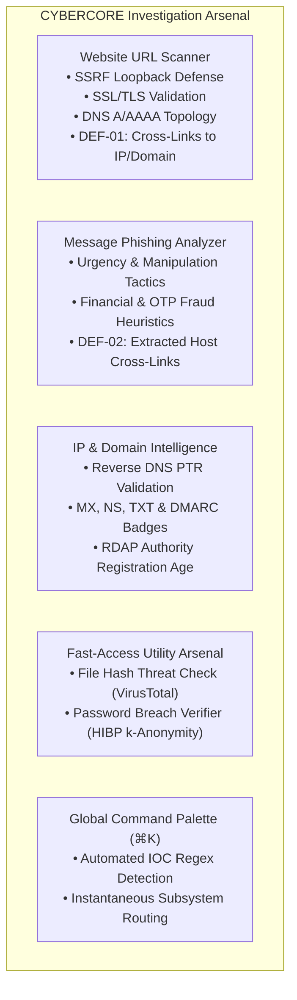

# CYBERCORE // FRONTEND RELEASE FREEZE DOCUMENTATION

**Platform:** CYBERCORE // Threat Intel & Security Investigation Platform  
**Target Environment:** Frontend (`/Users/yashrajdnyaneshwarkuyate/cybercore_fr`)  
**Backend Reference:** FastAPI Backend (`/Users/yashrajdnyaneshwarkuyate/CyberCore/backend`)  
**Freeze Authorization Date:** November 1, 2026  
**Release Status:** **`FROZEN — READY FOR SUBMISSION`**

---

## 1. Release Freeze Declaration

As authorized by the user, the CYBERCORE frontend implementation is **OFFICIALLY FROZEN**.

> [!IMPORTANT]
> **GOVERNANCE DIRECTIVE:**
> No further source code, architectural, component, styling, routing, or dependency modifications are authorized without explicit stakeholder re-authorization. The current code snapshot represents the final project submission state.

---

## 2. Platform Overview & Technology Stack

The platform is built on modern, production-grade enterprise specifications:

- **Framework:** Next.js 14.2.35 (React Server Components, App Router)
- **UI Runtime:** React 18.3.1
- **Language:** TypeScript 5.6.3 (strict type checking enabled)
- **Styling:** Tailwind CSS 3.4.14 with CSS custom design tokens
- **Primitives:** Radix UI (`@radix-ui/react-dialog`, `@radix-ui/react-dropdown-menu`, `@radix-ui/react-separator`, `@radix-ui/react-tooltip`)
- **Icons:** Lucide React (v0.454.0)
- **Typography:** Geist Sans & Geist Mono (`geist` package)
- **Animation & Transitions:** Tailwind transitions + CSS keyframes (respects `prefers-reduced-motion`)

---

## 3. Verified Frontend Routes

All routes have been verified operational with clean HTTP 200/307 status codes, zero console exceptions, and full document scroll reachability:

| Route Path | Type | Purpose / Description |
|:---|:---:|:---|
| `/` | Page | Security Posture & Threat Overview Dashboard |
| `/dashboard` | Route | Canonical redirect to `/` |
| `/investigations` | Page | Recent Investigation Samples & Historic Audit Archive |
| `/threat-intelligence` | Page | Curated Threat Intelligence Reference Feeds |
| `/security-tools` | Page | Fast-Access Investigation Arsenal Directory |
| `/security-tools/url-scanner` | Page | Synchronous Website URL Scanner & Subsystem Inspector |
| `/security-tools/message-analyzer` | Page | Message Phishing & Social Engineering Heuristic Analyzer |
| `/security-tools/ip-domain-analyzer`| Page | IP Routability, PTR, Authoritative DNS & RDAP Inspector |
| `/assistant` | Page | AI-Assisted Security Investigation Terminal |
| `/_not-found` | Page | Custom 404 System Diagnostic Shell |

---

## 4. Completed Investigation Subsystems & Modules



1. **Website URL Scanner (`/security-tools/url-scanner`):** Synchronous inspection engine with active SSRF defense against RFC 1918 loopback addresses (`127.0.0.1`, `localhost`).
2. **Message Phishing Analyzer (`/security-tools/message-analyzer`):** Rule-based deterministic heuristic engine evaluating urgency pressure, fake verification, and credential harvesting.
3. **IP & Domain Intelligence Analyzer (`/security-tools/ip-domain-analyzer`):** Validates IP routability, reverse DNS, authoritative DNS records, RDAP registration age, and DMARC enforcement states (`VALID`, `MISSING`, `MALFORMED`, `UNAVAILABLE`).
4. **Password Breach Verifier (`/security-tools?tool=password`):** Secure k-Anonymity privacy checker querying HIBP SHA-1 prefixes without exposing raw passwords.
5. **Command Palette (`⌘K`):** Global navigation and IOC classifier routing directly into appropriate investigative subsystems.
6. **Cross-Module Handoffs:** Fully operational links (DEF-01 and DEF-02) bridging scan targets directly into the IP & Domain Analyzer.

---

## 5. Visual Identity & Design System

The platform strictly preserves the established design direction:

### **OBSIDIAN LUXURY × ARCTIC GLASS × MONOLITHIC BRUTALISM**

1. **Dual-Theme Support:**
   - **Obsidian Luxury (Dark):** Monolithic obsidian background (`#05070a`), semi-transparent glass paneling (`rgba(13, 17, 23, 0.78)`), internal specular highlights (`rgba(255, 255, 255, 0.08)`), and official metallic silver branding.
   - **Arctic Glass (Light):** Crisp arctic surface (`#f8fafc`), high-translucency paneling (`rgba(255, 255, 255, 0.84)`), bright specular reflections (`rgba(255, 255, 255, 0.90)`), and dark metallic branding.
   - **Zero FOUC:** Inline theme initializer script in `layout.tsx` guarantees instant, flicker-free theme application.
2. **Monolithic Tactical Brutalism:**
   - Architectural 10px 2-border corner framing brackets (`border-t-2 border-l-2`, `border-b-2 border-r-2`).
   - Monospaced technical indexing (`// 01`, `// 02`, `// ARSENAL`, `// ARCHIVE`).
3. **Branded Initialization Loader:**
   - Single authoritative lifecycle controller.
   - Strictly enforces **2,500ms minimum display duration** before smooth 500ms fade dismissal.
   - Client-side Next.js route navigation incurs **0ms delay**.
   - Body scroll locking is completely removed upon dismissal.

---

## 6. Backend Integration Summary

- **API Architecture:** REST API client interfacing with FastAPI backend (`http://localhost:8000/api/v1`).
- **Client Implementation:** `src/lib/api/client.ts` featuring automatic 30s timeout aborts, typed error boundaries (`ApiError`), and unified response handling.
- **Configurability:** Centralized in `src/config/api.ts` via `process.env.NEXT_PUBLIC_API_BASE_URL`.

---

## 7. Quality Gate Audit Verification

All quality gates passed with zero warnings or errors prior to freeze:

```
$ npm run typecheck
Exit Code: 0 (No type errors)

$ npm run lint
Exit Code: 0 (✔ No ESLint warnings or errors)

$ npm run build
Exit Code: 0 (14/14 static pages generated cleanly)
```

DevTools console reports **0 errors** across all tested routes and viewports.

---

## 8. Known Operational Characteristics & Disclaimers

1. **Unconfigured Threat Feeds:** External threat intelligence feeds (VirusTotal, Google Safe Browsing, URLhaus) require API keys in the backend `.env`. In their absence, feeds are explicitly labelled `FEED OFFLINE: Marked UNAVAILABLE and excluded from composite score` rather than falsely reported as clean.
2. **Heuristic Scope:** Social engineering analysis is rule-based and deterministic. The UI explicitly states that heuristics do not utilize predictive ML and cannot guarantee 100% absence of threat.
3. **Network Telemetry Scope:** IP & Domain analysis queries public DNS and RDAP authorities directly. It does not integrate external GeoIP, ASN, or commercial abuse databases (explicitly disclaimed in UI).

---

## 9. Production Deployment Prerequisites

Before deploying to public infrastructure (e.g. Vercel, Netlify, Cloud Run, AWS):

1. **Backend CORS Configuration:**  
   Configure `CORS_ORIGINS` in the backend environment to whitelist the production frontend domain (e.g. `CORS_ORIGINS=https://cybercore.yourdomain.com`).
2. **Frontend Environment Variable:**  
   Supply `NEXT_PUBLIC_API_BASE_URL` in the deployment environment matching the public backend API endpoint.
3. **Security Headers (Edge / CDN):**  
   Configure standard edge security headers (`X-Frame-Options: DENY`, `X-Content-Type-Options: nosniff`, `Strict-Transport-Security`) at the hosting/CDN layer (e.g. Vercel or Cloudflare).

---

## 10. Audit Artifacts & Historical Record

The following comprehensive audit reports are preserved in the project root:
- `CYBERCORE_FINAL_RELEASE_AUDIT.md`: Complete 10-area platform audit, viewport testing, and acceptance verdict.
- `CYBERCORE_FINAL_EVIDENCE_VERIFICATION.md`: Forensic exit-code analysis, secret scan verification, CORS/headers investigation, and truth-in-advertising checks.
- `CYBERCORE_RELEASE_FREEZE.md`: This official freeze record.

---

## 11. Final Authorization Sign-off

```
================================================================================
FREEZE STATUS: ACTIVE & ENFORCED
VERDICT:       READY FOR SUBMISSION
AUTHORIZATION: USER APPROVED — NOVEMBER 1, 2026
================================================================================
```

